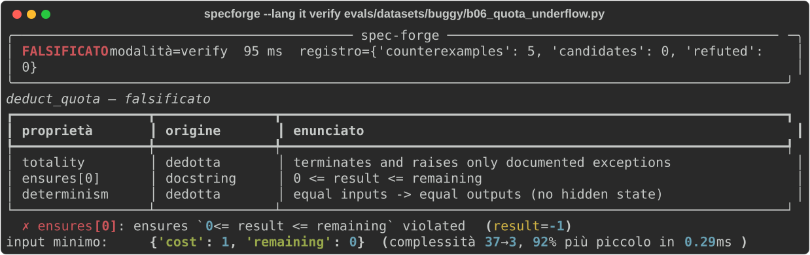
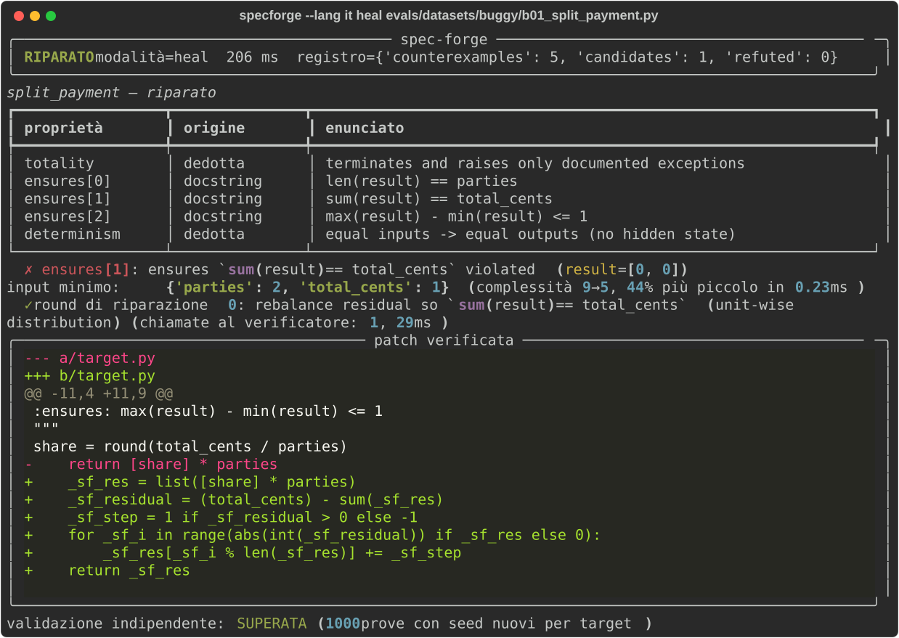
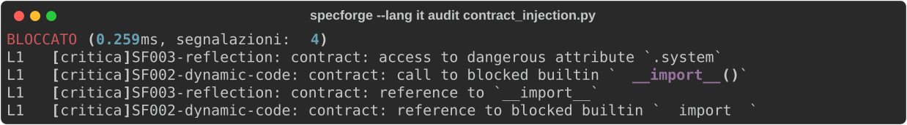
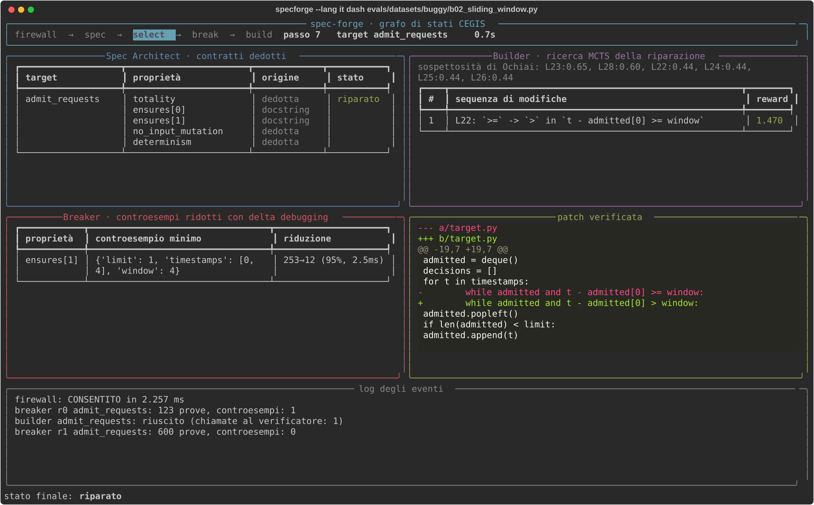

# spec-forge

[English](README.md) | **Italiano**

**I tuoi test passano, ma solo sugli input a cui qualcuno ha pensato. spec-forge cerca l'input che
fa sbagliare la tua funzione Python, poi prova a correggerla e verifica la correzione.**

Scrivi nella docstring cosa garantisce una funzione (per esempio `sum(result) == total_cents`),
oppure lasci che spec-forge deduca da solo garanzie comuni come il determinismo o la
reversibilità di una codifica. Cerca un input che violi la garanzia, lo riduce al caso più piccolo
che fallisce e propone una piccola patch, che ricontrolla su tutti i casi falliti trovati fino a
quel momento. Gira offline sulla tua macchina, senza API key; un LLM è facoltativo.

È pensato per chi sviluppa in Python e vuole controlli più solidi dei test basati su esempi, su
funzioni autonome: calcoli con importi, parser, paginazione, encoder. È un progetto di ricerca;
[Limiti e prossimi passi](#limiti-e-prossimi-passi) elenca ciò che non sa riparare.

## Provalo in 30 secondi

```bash
git clone https://github.com/giuseppegambino92/spec-forge.git && cd spec-forge
python -m venv .venv && source .venv/bin/activate
pip install -e ".[dev]"

specforge verify evals/datasets/buggy/b06_quota_underflow.py   # trova un input che fallisce e lo riduce
specforge heal   evals/datasets/buggy/b01_split_payment.py     # ripara il bug e mostra il diff verificato
```

spec-forge non è su PyPI; installalo da un clone come sopra. Entrambi i file sono inclusi nel
repository.

## Cosa c'è dentro

In termini tecnici: **verifica del codice multi-agente neuro-simbolica e sintesi auto-riparante
per Python.**

spec-forge deduce ciò che il
codice *promette* (contratti, leggi di conservazione, idempotenza, invertibilità round-trip,
purezza, atomicità...), cerca in modo avversariale un input che infranga la promessa, lo riduce a
un controesempio minimo e poi ripara il codice con una Monte Carlo Tree Search sulle modifiche
dell'AST. Ogni patch candidata viene riverificata contro ogni controesempio mai trovato, in un
ciclo di Counterexample-Guided Inductive Synthesis (CEGIS).

L'intero motore è Python scritto da zero, **senza framework di IA** (niente LangChain, LangGraph,
AutoGen o CrewAI): il grafo di stati ciclico, il pianificatore MCTS, lo shrinker a delta-debugging,
il risolutore di vincoli a intervalli, il firewall, la sandbox e il server MCP sono tutti in questo
repository. Per impostazione predefinita funziona **al 100% offline e in modo deterministico**.
Gli LLM (Anthropic, OpenAI, Ollama) sono politiche di proposta opzionali, e il loro output è
sottoposto allo stesso verificatore di ogni altro candidato.

---

## Screenshot

Sono registrazioni di esecuzioni reali di `specforge` sui moduli del benchmark inclusi in
[`evals/datasets`](evals/datasets), con il motore offline predefinito e la sandbox a
sottoprocesso. Niente è ritoccato a mano: [`scripts/make_screenshots.py`](scripts/make_screenshots.py)
sostituisce la console Rich della CLI con una `Console(record=True)` che registra l'output e lo
esporta con `export_svg`, quindi i tempi sono quelli misurati in quella esecuzione. Le immagini
qui sotto mostrano l'output in italiano, ottenuto con `--lang it`. Per rigenerare entrambe le
serie di immagini, eseguire `python scripts/make_screenshots.py` dalla radice del repository.

**Falsificazione.** `specforge verify` su B06 (`deduct_quota`, underflow di una quota senza
segno). Le proprietà dedotte e quelle dei docstring sono elencate con la loro origine; la
postcondizione `:ensures:` viene violata e il delta debugging riduce l'input che la fa fallire a
`{'cost': 1, 'remaining': 0}`.



**Riparazione.** `specforge heal` su B01 (`split_payment`, perdita di conservazione per
arrotondamento). L'output mostra il controesempio minimo, la riparazione trovata al primo round,
il diff verificato e la validazione indipendente con seed nuovi del modulo corretto.



**Firewall.** `specforge audit` sul payload `contract_injection` di
[`evals/datasets/adversarial_payloads.py`](evals/datasets/adversarial_payloads.py), salvato in un
file. La chiamata malevola è nascosta in un contratto `:ensures:`; l'audit statico la blocca e
nessun codice viene eseguito.



**Dashboard in tempo reale.** L'ultimo frame di `specforge dash` su B02 (`admit_requests`,
off-by-one nella finestra scorrevole): contratti dedotti, il controesempio ridotto con delta
debugging, il candidato MCTS con il suo reward e la sospettosità di Ochiai, la patch verificata e
il log degli eventi.



---

## Risultati misurati

Il benchmark è stato eseguito **3 volte consecutive** con `python -m evals.repeat_runs` il
2026-11-14, su Apple Silicon (arm64, 14 core), macOS 27.2, Python 3.11.18, con la sandbox a
sottoprocesso attiva. Ogni esecuzione è partita solo a macchina quieta: il carico medio a 1 minuto
era 0,31–0,33 per core, con una soglia di 0,35. Ogni esecuzione è durata 34,4–35,3 s.

Dove un valore è cambiato tra un'esecuzione e l'altra, la tabella riporta l'**intervallo
min–max sulle 3 esecuzioni**. Un valore singolo significa che tutte e 3 le esecuzioni hanno
coinciso esattamente. I dati sono in
[`evals/repeatability_report.json`](evals/repeatability_report.json), e il report completo
dell'ultima esecuzione è [`evals/latest_report.json`](evals/latest_report.json).

| Metrica | Obiettivo | Test unitari ingenui | **spec-forge (misurato, 3 esecuzioni)** |
|---|---|---|---|
| Scoperta di bug silenziosi | ≥ 90% | 0 / 12 (0%) | **12 / 12 (100%)** in ogni esecuzione. Tutti i 15/15 controesempi sono stati confermati come bug reali rieseguendoli contro la correzione di riferimento. **0 / 12 falsi allarmi** sulle versioni corrette. |
| Riduzione dei controesempi | > 80% di riduzione in < 50 ms | n/d | **96,28–96,30%** di riduzione aggregata (83,69–83,90% di media per campione) su 36 input grandi. Mediana **0,33–0,36 ms**, p95 2,94–3,02 ms, caso peggiore 27,9–28,5 ms. Il **100%** dei campioni è terminato sotto i 50 ms in ogni esecuzione. |
| Riparazione CEGIS autonoma | ≥ 85% | n/d | **12 / 12 (100%)** in ogni esecuzione. Ogni patch ha superato una campagna avversariale indipendente da **1.000 prove** con seme nuovo e ha concordato al **100%** con la correzione di riferimento su 1.000 input differenziali (100 esecuzioni dell'harness a thread per B11). |
| Blocco di payload / sandbox | 100% in < 2 ms | n/d | **20 / 20 bloccati (100%)** in ogni esecuzione. Media **0,074–0,076 ms**, singolo audit peggiore **0,13–0,19 ms**. 24 / 24 moduli legittimi ammessi. |

Altri valori misurati:

- **Tempo al primo fallimento:** mediana di 3 prove, ovvero 0,65–0,67 ms.
- **Riduzione dei controesempi ordinari delle campagne:** 83,37–83,57% di riduzione aggregata,
  mediana 0,15–0,16 ms, 100% sotto i 50 ms.
- **Costo di riparazione:** mediana di 1 chiamata al verificatore. Riparare un modulo richiede
  una mediana di 103–104 ms dall'inizio alla fine.
- **Ablazione, MCTS con prior uniformi e senza localizzazione dei guasti:** ripara comunque
  12 / 12 bug, ma richiede in media 4,92 chiamate al verificatore invece di 2,0 (25 invece di 1
  su B05).

**Ripetibilità.** Ogni esito discreto è stato identico in tutte e 3 le esecuzioni: bug trovati,
controesempi e relativi input minimi, prove fino al primo fallimento, patch e diff, chiamate al
verificatore, concordanza con l'oracolo, complessità dopo la riduzione e verdetti del firewall.
L'unica eccezione dichiarata è il caso di concorrenza B11, che dipende dallo scheduling dei
thread del sistema operativo. I suoi campi di esito (trovato, riparato, validato, concordanza con
l'oracolo al 100%) hanno coinciso, ma il suo controesempio minimo è variato tra 2 e 4 thread.
Questa variazione spiega anche perché le percentuali aggregate di riduzione cambiano alla seconda
cifra decimale. Le metriche temporali hanno avuto un coefficiente di variazione di al massimo
3,4%, tranne il singolo audit peggiore del firewall (19%, un valore anomalo da 0,13 → 0,19 ms).

**I tempi dipendono dal carico della macchina.** Un'esecuzione singola precedente, in una
sessione più carica, è durata 52,9 s e ha misurato una riduzione peggiore di 50,6 ms (97,2% dei
campioni sotto i 50 ms) e un singolo audit peggiore di 0,89 ms. Gli esiti discreti erano identici
a quelli delle esecuzioni sopra. Per questo `evals/repeat_runs.py` attende una macchina quieta
prima di ogni esecuzione.

### Per classe di bug

| # | Classe di bug (dominio) | Proprietà violata trovata | Controesempio minimo | Patch verificata |
|---|---|---|---|---|
| B01 | Perdita di conservazione per arrotondamento (finanza) | `:ensures: sum(result) == total_cents` | `split_payment(total_cents=1, parties=2)` | ribilanciamento del residuo guidato dal contratto |
| B02 | Off-by-one sul confine della finestra scorrevole (rate limiting) | al più `limit` ammissioni in ogni finestra chiusa | `limit=1, timestamps=[0, 4], window=4` | `>=` → `>` (L22) |
| B03 | Normalizzazione non idempotente (ricerca) | `f(f(x)) == f(x)` e `"  " not in result` | `text='0   0'` | chiusura a punto fisso |
| B04 | Corruzione di stato da default mutabile | determinismo / nessuna mutazione degli input | `register_event(name='')` chiamata due volte | copia difensiva in ingresso |
| B05 | Divisione per zero su varianza degenere | totalità | `zscores(samples=[0.0])` | guardia sul divisore (L15) |
| B06 | Underflow di quota senza segno | `:ensures: 0 <= result <= remaining` | `remaining=0, cost=1` | clamp derivato da `:ensures:` |
| B07 | Deriva in virgola mobile / dipendenza dall'ordine (registro contabile) | invarianza per permutazione | 3 registrazioni | `sum` → `math.fsum` |
| B08 | Off-by-one sul limite di slice (paginazione) | `:law:` di partizione | `items=[0], page=0, size=1` | letterale `1` → `0` (L13) |
| B09 | Invertibilità round-trip (codec RLE) | `decode(encode(x)) == x` | `data=' '` | `j - i` → `j - i + 1` (12 chiamate al verificatore) |
| B10 | Aliasing dell'input (ordinamento in place) | nessuna mutazione degli input | `scores=[0, 1], k=0` | copia difensiva in ingresso |
| B11 | Race condition, aggiornamento perso | atomicità (concorrente ≡ sequenziale) | 2–4 thread × 1 chiamata (varia con lo scheduling) | `RLock` per istanza attorno al read-modify-write |
| B12 | Indice fuori dai limiti a p = 100 | totalità | `percentile(values=[0.0], p=100.0)` | clamp dell'indice (L14) |

### Come leggere questi numeri

Leggere queste avvertenze prima di citare i risultati.

- **La baseline ingenua di 0/12 vale per costruzione.** Ogni suite ingenua in
  [`evals/datasets/naive_suites.py`](evals/datasets/naive_suites.py) è il test del "percorso
  felice" che realisticamente accompagna codice del genere. Il benchmark verifica che queste
  suite passino sia sulle versioni con bug sia su quelle corrette: non rilevano i bug, ma non sono
  esse stesse difettose.
- **Il corpus e la grammatica di riparazione hanno lo stesso autore.** Tutti i 12 bug rientrano
  nella portata della grammatica di riparazione, e i prior dell'MCTS associano ogni tipo di
  violazione alle categorie di modifica che probabilmente la correggono. Per questo la mediana è di
  1 chiamata al verificatore. L'ablazione con prior uniformi mostra che la ricerca riesce anche
  senza questa conoscenza, a circa 2,5× il costo. Il benchmark non dimostra prestazioni generali di
  riparazione automatica su bug reali arbitrari. I bug fuori dalla grammatica richiedono la
  politica LLM opzionale, e nessun LLM reale è stato sottoposto a benchmark.
- **"Verificato" significa verifica limitata, non dimostrazione.** Una patch conta come
  verificata quando supera ogni controesempio registrato, una campagna rapida a seme fisso e poi
  1.000 nuove prove avversariali. Il risolutore di vincoli è un dominio astratto a intervalli sulle
  precondizioni, non un risolutore SMT completo. Per difendersi da patch che aggirano la
  specifica, ogni patch viene anche confrontata con una correzione di riferimento indipendente (la
  colonna dell'oracolo). Questo ha intercettato un problema reale durante lo sviluppo: B04
  inizialmente otteneva solo l'83,5% di concordanza perché l'oracolo campionava input al di fuori
  del contratto originale. L'oracolo è stato corretto per usare il contratto del codice in
  riparazione, e ora B04 ottiene il 100%.
- **La concorrenza viene rilevata statisticamente.** B11 viene trovato stressando lo scheduling
  dei thread (intervallo di commutazione di 1 µs) e confrontando con un'esecuzione sequenziale, non
  tramite un'esplorazione esaustiva degli interleaving. Il suo oracolo ha usato 100 esecuzioni
  dell'harness a thread invece di 1.000, perché ogni esecuzione è costosa.
- **L'elenco dei payload è nostro.** I 20 payload avversariali in
  [`evals/datasets/adversarial_payloads.py`](evals/datasets/adversarial_payloads.py) sono stati
  scritti per questo progetto. Un'allowlist/denylist statica non può essere completa. Vedere
  [Modello di sicurezza](#modello-di-sicurezza).

---

## Architettura

```
                         ┌───────────────────────── Grafo di stati ciclico orientato (orchestrator/state_graph.py) ─────────────────────────┐
 sorgente ──► FIREWALL ──► SPEC ARCHITECT ──► scelta target ──► BREAKER ──(nessun controesempio)──► target successivo ──► … ──► report + diff
               audit AST     AST + tipi +             ▲                │ fuzzing guidato dalla copertura e orientato ai confini
               statico       contratti nei docstring  │                │ + shrinker gerarchico a delta-debugging
                             → TargetSpec (dati)      │                ▼ (controesempio)
                                                      │            BUILDER: spettri settrace → localizzazione dei guasti Ochiai
                                                      │                     → PUCT-MCTS sulla grammatica di riparazione AST (+ proposte LLM opzionali)
                                                      │                     → il candidato deve superare OGNI controesempio del registro
                                                      └─────────── candidato ──┘   (il Breaker lo riattacca con un seme nuovo;
                                                                                    i candidati confutati finiscono in blacklist: niente oscillazioni)
               Registro episodico dei controesempi: SQLite WAL (orchestrator/memory.py)     Bus di eventi → TUI Rich / MCP
               Tutto il codice target gira nel worker della sandbox: sottoprocesso + rlimit + watchdog RSS + builtin ristretti + import controllati
```

### Gli agenti

**Spec Architect** ([`agents/spec_agent.py`](src/spec_forge/agents/spec_agent.py),
[`symbolic/ast_analyzer.py`](src/spec_forge/symbolic/ast_analyzer.py),
[`symbolic/constraints.py`](src/spec_forge/symbolic/constraints.py)). Combina tre fonti:

- **Contratti nei docstring:** `:requires:`, `:ensures:`, `:law:`, `:raises:`, `:inverse:`,
  `:idempotent:`, `:thread_safe:`.
- **Flusso di dati dell'AST:** mutazione in place dei parametri, default mutabili, fonti di
  non-determinismo, eccezioni sollevate esplicitamente, schemi read-modify-write su `self` e punti
  a rischio (divisione, indicizzazione calcolata, sottrazione, `sum` in virgola mobile).
- **Convenzioni di nomenclatura,** ciascuna con un punteggio di confidenza: `normalize*`/`canonical*`
  implicano idempotenza, `encode`/`decode`, `to_x`/`from_x` e coppie simili implicano un round
  trip, e gli aggregati `*total*` implicano indipendenza dall'ordine.

Le precondizioni vengono compilate in intervalli per variabile da un risolutore a dominio astratto
a intervalli. Gestisce catene di confronti, `len(xs)`, `abs(x)`, `all(lo <= v <= hi for v in xs)`,
lo spacchettamento di tuple come `for _, n in runs`, `math.isfinite` e `xs == sorted(xs)`. Il
Breaker usa questi intervalli per generare input *dentro* la precondizione e colpirne i confini.

**Breaker** ([`agents/breaker_agent.py`](src/spec_forge/agents/breaker_agent.py),
[`symbolic/shrinker.py`](src/spec_forge/symbolic/shrinker.py)) genera input che sono:

- **guidati dai tipi,** a partire dalle annotazioni;
- **orientati ai confini:** estremi degli intervalli, 0 e ±1, NaN, ±Inf, `-0.0`, `5e-324`, trappole
  Unicode (ZWSP, segni combinanti, override RTL, NUL, BOM...), e collezioni vuote, a singolo
  elemento, di dimensione massima, con tutti gli elementi uguali, ricche di duplicati o ordinate;
- **guidati dalla copertura:** un corpus di archi di righe raccolto con `sys.settrace`, limitato
  ai frame del target, alimenta le mutazioni.

Le classi che menzionano la concorrenza, o che dichiarano `:thread_safe:`, vengono attaccate con
un harness di thread sincronizzati da una barriera, con un intervallo di commutazione di 1 µs, e il
risultato viene confrontato con un'esecuzione sequenziale delle stesse chiamate.

Gli input che falliscono vengono ridotti con un passaggio gerarchico di delta-debugging:

1. Rimozione a blocchi ddmin su liste, stringhe, insiemi e dizionari.
2. Discesa ricorsiva negli elementi.
3. Semplificazione degli scalari: interi tramite ricerca di magnitudine da grossolana a fine verso
   0, float verso valori interi brevi, caratteri verso `'a'`/`' '`.
4. Traslazione delle sequenze di interi verso l'origine.

I passi accettati fanno diminuire strettamente un ordine ben fondato (complessità, magnitudine),
quindi la riduzione termina sempre.

**Builder** ([`agents/builder_agent.py`](src/spec_forge/agents/builder_agent.py),
[`agents/repair_grammar.py`](src/spec_forge/agents/repair_grammar.py)) lavora in tre passi:

1. **Traccia.** Traccia gli input che falliscono e quelli che passano nella sandbox, registrando
   gli spettri delle righe e istantanee dello stato delle variabili del controesempio minimo.
2. **Localizza.** Ordina le righe con il coefficiente di Ochiai. Le righe in cui è stata sollevata
   un'eccezione ottengono punteggio 1.
3. **Cerca.** Esegue una MCTS guidata da PUCT con allargamento progressivo sulla grammatica di
   riparazione. Il prior di ogni azione è (affinità tipo di violazione × categoria di modifica) ×
   sospettosità della riga. Il valore di ogni nodo è un punteggio del verificatore: la frazione di
   controesempi del registro che supera, più la frazione di proprietà che sopravvivono a una
   campagna a seme fisso. Non ci sono rollout casuali.

I punteggi usati dal Builder, esattamente come implementati in `builder_agent.py`, sono riportati
sotto. Per la riga $`\ell`$, $`e_f(\ell)`$ e $`e_p(\ell)`$ contano le esecuzioni fallite e
riuscite che la eseguono, e $`F`$ è il numero totale di esecuzioni fallite:

```math
\mathrm{susp}(\ell) = \frac{e_f(\ell)}{\sqrt{F \cdot \bigl(e_f(\ell) + e_p(\ell)\bigr)}}
```

La selezione (PUCT) usa il valore medio $`Q`$, il prior $`P`$, i conteggi di visita $`N`$ e
$`c_{\text{puct}} = 1.4`$:

```math
a^{*} = \arg\max_{a} \left[ Q(s,a) + c_{\text{puct}} \, P(s,a) \, \frac{\sqrt{N(s) + 1}}{1 + N(s,a)} \right]
```

Un nodo può espandere un nuovo figlio solo finché ha meno di questo numero di figli
(allargamento progressivo):

```math
\max\!\left(2,\; \bigl\lfloor 2\sqrt{N(s) + 1} \bigr\rfloor\right)
```

Il valore di un candidato a profondità $`d`$ è riportato sotto. $`C^{+}`$ dei $`C`$ controesempi del registro
vengono superati, $`K^{+}`$ delle $`K`$ proprietà sopravvivono alla campagna rapida, e $`\sigma`$ vale 1
quando tutto passa e 0 altrimenti:

```math
R = 0.6 \, \frac{C^{+}}{C} + 0.4 \, \frac{K^{+}}{K} - 0.03 \, d + 0.5 \, \sigma
```

La grammatica di riparazione ha due tipi di regole:

- **Regole locali, ancorate alle righe sospette:** scambio di confronto, letterale ±1, ±1 su
  aritmetica, limiti di slice e di `range`, scambio `+`/`-` e `/`/`//`, guardia sul divisore nullo,
  clamp dell'indice, sottrazione saturante e `sum` → `math.fsum`.
- **Modelli a livello di funzione:** clamp ai limiti derivati da `:ensures:`, ribilanciamento del
  residuo di conservazione derivato da `sum(result) == E`, copia difensiva, sentinella per default
  mutabili, chiusura a punto fisso per l'idempotenza e isolamento con lock per istanza.

Le patch vengono applicate **testualmente sugli intervalli esatti dei nodi**, quindi i diff
prodotti sono minimi invece di una riformattazione dell'intero file con `ast.unparse`.

**Firewall e sandbox** ([`sandbox/firewall.py`](src/spec_forge/sandbox/firewall.py),
[`sandbox/runner.py`](src/spec_forge/sandbox/runner.py)) sono descritti in
[Modello di sicurezza](#modello-di-sicurezza).

---

## Avvio rapido

```bash
python -m venv .venv && source .venv/bin/activate
pip install -e ".[dev]"

specforge audit  path/to/module.py            # solo firewall statico (nessuna esecuzione)
specforge verify path/to/module.py            # deduce proprietà + falsifica; exit 1 se trova un controesempio
specforge heal   path/to/module.py --out fixed.py   # riparazione CEGIS + validazione indipendente da 1.000 prove
specforge dash   path/to/module.py            # dashboard Rich del ciclo in tempo reale
specforge eval                                # esegue il benchmark (dalla radice del repository)
specforge mcp                                 # server MCP su stdio
specforge --lang it verify path/to/module.py  # output in italiano (oppure: export SPECFORGE_LANG=it)

python -m evals.benchmark_suite               # un'esecuzione del benchmark -> evals/latest_report.json
python -m evals.repeat_runs --update-latest   # 3 esecuzioni a macchina quieta + verifica di ripetibilità
```

**Lingua dell'output.** L'output leggibile è in inglese per impostazione predefinita. Per
l'italiano, passare l'opzione globale `--lang it` prima del comando, oppure impostare
`SPECFORGE_LANG=it` (un `--lang` esplicito ha la precedenza; un valore sconosciuto nella variabile
ricade sull'inglese). Anche l'help di comandi e opzioni segue questa impostazione; le etichette
dell'help generate dal framework (Usage, Options, ...) restano in inglese. L'output leggibile
dalle macchine non viene mai tradotto: i report `--json`, i risultati MCP, i diff e i sorgenti
corretti sono identici nelle due lingue. Lo stesso vale per i messaggi prodotti dal motore
(enunciati delle proprietà, messaggi dei controesempi, descrizioni delle modifiche di riparazione
e messaggi delle regole del firewall), che fanno parte del report JSON.

Scrivere i contratti nei docstring. Tutto il resto viene dedotto.

```python
def split_payment(total_cents: int, parties: int) -> list[int]:
    """Split a bill into near-equal integer shares.

    :requires: 0 <= total_cents <= 10**9
    :requires: 1 <= parties <= 50
    :ensures: len(result) == parties
    :ensures: sum(result) == total_cents
    :ensures: max(result) - min(result) <= 1
    """
    share = round(total_cents / parties)
    return [share] * parties
```

```
$ specforge heal split.py
  ✗ ensures[1]: ensures `sum(result) == total_cents` violated (result=[0, 0])
    minimal input: {'parties': 2, 'total_cents': 1}
  ✓ repair round 0: rebalance residual so `sum(result) == total_cents` (unit-wise distribution)
independent validation: PASS (1000 fresh-seed trials per target)
```

Le clausole `:law:` sono relazioni metamorfiche e possono chiamare funzioni del modulo:

```python
:law: [x for p in range(len(items) // size + 1) for x in paginate(items, p, size)] == items
```

### API Python

```python
from spec_forge import SpecForge, SpecForgeConfig

with SpecForge(SpecForgeConfig()) as sf:
    report = sf.heal(open("module.py").read())
    print(report["status"], report["diff"])
```

### MCP

```json
{ "mcpServers": { "spec-forge": { "command": "specforge", "args": ["mcp"] } } }
```

Il server implementa JSON-RPC 2.0 su stdio (`initialize`, `tools/list`, `tools/call`, `ping`
e batch). Espone tre strumenti:

- `specforge_verify`: deduce le proprietà e le falsifica; restituisce controesempi minimi.
- `specforge_heal`: esegue l'intero ciclo CEGIS; restituisce il diff verificato e il sorgente
  corretto.
- `specforge_audit`: esegue solo l'audit statico del firewall.

I risultati vengono restituiti sia come testo sia come `structuredContent`.

### Politica LLM opzionale

```bash
export ANTHROPIC_API_KEY=...
specforge heal module.py --llm anthropic                 # POST /v1/messages, modello predefinito claude-opus-5-5
specforge heal module.py --llm openai --model <model-id> # POST /v1/chat/completions
specforge heal module.py --llm ollama --model llama3.1   # POST /api/chat
```

Gli adattatori in [`llm/adapters.py`](src/spec_forge/llm/adapters.py) usano solo `urllib` della
libreria standard, senza SDK. L'adattatore Anthropic invia `fallbacks: "default"` con l'header
beta `server-side-fallback-2026-07-01`, così un rifiuto del classificatore di sicurezza viene
ritentato lato server su un modello di riserva. Un rifiuto che arriva comunque solleva
`LLMRefusal`. Passare `AnthropicAdapter(fallbacks=None)` per disattivare il fallback.

Le proposte degli LLM diventano azioni MCTS aggiuntive. Vengono analizzate, sottoposte all'audit
del firewall (il modulo viene passato al modello dentro un blocco `<untrusted_module>`) e valutate
dallo stesso verificatore delle modifiche della grammatica, quindi una patch allucinata o malevola
può perdere la ricerca ma non vincerla mai. `tests/test_cegis_multi_agent_loop.py` copre una
politica che propone una patch con `import os`: il firewall la respinge e vince la proposta
corretta. Gli adattatori sono testati contro un server locale che parla il formato di rete di
ciascun provider. **Non è stata effettuata alcuna chiamata API reale** per questa build o per il
suo benchmark.

---

## Modello di sicurezza

spec-forge ha tre livelli di difesa. **Il sandboxing a livello di Python non è un confine di
sicurezza robusto.** Per codice davvero ostile, eseguire spec-forge dentro un container o una VM
(gVisor, Firecracker, nsjail).

### 1. Firewall statico (nessuna esecuzione)

La politica nega per impostazione predefinita le capacità:

- **Import:** sono ammessi solo i moduli presenti in un'allowlist.
- **Codice dinamico e riflessione:** `eval`, `exec`, `compile` e `__import__` sono bloccati, così
  come `open`, `globals` e `vars`. Lo stesso vale per `getattr` con un nome non letterale o
  privato. Ridefinire un nome nel proprio ambito lessicale è consentito; per esempio, un parametro
  chiamato `input` va bene.
- **Attraversamento di dunder e frame:** per esempio `__subclasses__`, `__globals__`, `gi_frame`,
  `f_back`.
- **Attraversamento tramite stringhe di formato:** per esempio `"{0.__class__}".format(x)`.
- **Letterali che esauriscono le risorse:** `while True` senza uscita, torri di potenze,
  `[0] * 10**10` e `range(10**12)`.
- **Prompt injection:** testo nei docstring, nei commenti e nelle stringhe, perché alimenta lo
  Spec agent e l'LLM opzionale.
- **Espressioni dei contratti:** anche ogni espressione di contratto incorporata viene sottoposta
  ad audit.
- **Limiti** su dimensione e numero di nodi dell'AST.

### 2. Isolamento dei processi

Tutto il codice target gira in un sottoprocesso worker persistente:

- Viene avviato con `-s -B`, un ambiente ripulito e una directory di lavoro temporanea vuota.
- Vengono applicati gli rlimit POSIX: CPU, dimensione dei file e core dump, più lo spazio di
  indirizzamento su Linux.
- **macOS ignora gli rlimit di memoria** (verificato su questa macchina), quindi il processo
  padre esegue un **watchdog RSS** che termina un worker che supera il limite di memoria. È stato
  aggiunto dopo che un `"a" * 2**33` generato dal fuzzer ha esaurito la memoria durante lo
  sviluppo.
- Ogni job ha un timeout rigido in tempo reale, seguito da terminazione e riavvio.
- I worker vengono riciclati quando un target bloccato lascia thread orfani.

### 3. Restrizioni dentro il worker

- I moduli target girano con builtin ristretti (niente `open`, `eval`, `exec`, `compile`,
  `input`, `globals`, `vars`, `setattr` e così via) e un import controllato.
- Ogni chiamata al target ha un budget di tempo SIGALRM, quindi la non terminazione diventa un
  controesempio `TimeoutError` invece di un blocco.
- I `print` del target non possono corrompere il canale del protocollo.

---

## Test

```bash
pytest     # 201 passed, 1 skipped (the RLIMIT_AS test only runs on Linux) in ~13–18 s
```

- **`test_invariants_and_shrinking.py`:** analisi dei contratti, inferenza di tipi e intervalli,
  semantica di ogni tipo di proprietà, chiamate protette, il codec, minimalità, budget e velocità
  dello shrinker.
- **`test_cegis_multi_agent_loop.py`:**
  - il grafo di stati (cicli, instradamento, budget, validazione) e il registro (WAL,
    deduplicazione, confutazione);
  - il Breaker e il Builder, compresi l'ordinamento di Ochiai, la blacklist anti-oscillazione e
    una politica neurale la cui proposta malevola viene bloccata dal firewall;
  - tutti i 12 bug riparati e validati, e tutte le 12 correzioni verificate senza falsi allarmi;
  - la vera sandbox a sottoprocesso, l'ablazione con prior uniformi e il flusso di eventi.
- **`test_sandbox_firewall.py`:**
  - tutti i 20 payload bloccati in meno di 2 ms, il corpus legittimo ammesso, la ridefinizione dei
    nomi consapevole dell'ambito e i controlli delle singole regole;
  - builtin ristretti e import controllato;
  - recupero da un job bloccato, terminazione da parte del watchdog RSS, e non terminazione
    segnalata come controesempio.
- **`test_mcp_and_cli.py`:**
  - handshake MCP, strumenti, errori, il ciclo stdio con i batch, e il server come vero
    sottoprocesso;
  - la CLI dall'inizio alla fine, e il rendering della TUI;
  - gli adattatori Anthropic, OpenAI e Ollama contro server locali nel formato di rete, la
    gestione dei rifiuti e una riparazione guidata dalla politica LLM.
- **`test_i18n.py`:** i cataloghi dei messaggi in inglese e in italiano hanno le stesse chiavi,
  gli stessi placeholder e lo stesso markup Rich; `--lang it` e `SPECFORGE_LANG=it` portano in
  italiano comandi reali, testi di help e dashboard, mentre il default resta l'inglese; l'output
  `--json` è identico nelle due lingue.
- **`test_docs.py`:** coerenza tra `README.md` e `README.it.md`:
  - i collegamenti tra le lingue in cima a entrambi i file;
  - blocchi `math` e frammenti di codice inline identici;
  - lo stesso multinsieme di numeri una volta normalizzati i formati locali (`1,000` ↔ `1.000`,
    `96.3` ↔ `96,3`), così nessun valore misurato può divergere tra le due lingue;
  - nessun underscore non preceduto da escape dentro un `\text{...}` in nessuno dei due file.

---

## Struttura del repository

```
src/spec_forge/
  config.py                  budget, limiti di riduzione, costanti MCTS, politica della sandbox
  i18n.py                    catalogo dei messaggi inglese / italiano per l'output di CLI e TUI (--lang, SPECFORGE_LANG)
  codec.py                   codec JSON senza perdite, uguaglianza consapevole dei NaN, metrica di complessità
  orchestrator/state_graph.py  macchina a stati ciclica senza framework + bus di eventi
  orchestrator/memory.py     registro episodico dei controesempi (SQLite WAL)
  orchestrator/cegis.py      il grafo CEGIS + facciata SpecForge (audit/verify/heal/validate)
  symbolic/ast_analyzer.py   tipi, contratti, flusso di dati, punti a rischio, rilevamento RMW
  symbolic/constraints.py    risolutore di precondizioni a dominio astratto a intervalli
  symbolic/invariants.py     DSL delle proprietà (dati) + semantica eseguibile
  symbolic/shrinker.py       shrinker gerarchico a delta-debugging
  agents/spec_agent.py       estrazione dei contratti e sintesi delle proprietà
  agents/breaker_agent.py    fuzzer avversariale guidato dalla copertura + harness di concorrenza
  agents/builder_agent.py    tracciamento, localizzazione Ochiai, ricerca di riparazioni PUCT-MCTS
  agents/repair_grammar.py   grammatica di trasformazioni AST con patch testuali sugli intervalli esatti
  sandbox/firewall.py        firewall statico di taint e capacità
  sandbox/runner.py          worker della sandbox, rlimit, watchdog RSS, esecuzione ristretta
  llm/adapters.py, llm/policy.py   adattatori Anthropic / OpenAI / Ollama + politica di proposta neurale
  interfaces/cli.py, mcp_server.py, tui.py
evals/
  benchmark_suite.py         il benchmark (scrive evals/latest_report.json)
  repeat_runs.py             N esecuzioni a macchina quieta + verifica di ripetibilità (scrive evals/repeatability_report.json)
  datasets/buggy/*.py        12 moduli con bug       datasets/reference/*.py  le loro correzioni
  datasets/naive_suites.py   test del percorso felice  datasets/adversarial_payloads.py  20 payload
tests/                       suite pytest
scripts/make_screenshots.py  rigenera docs/images/{en,it}/*.svg da esecuzioni reali della CLI
```

## Limiti e prossimi passi

- L'inferenza delle proprietà dai nomi è euristica ed è etichettata con punteggi di confidenza. I
  contratti nei docstring sono il canale preciso.
- Il supporto alle classi riguarda l'atomicità dei metodi read-modify-write. Il testing generale
  basato su modelli di sequenze di metodi con stato non è ancora implementato.
- La grammatica di riparazione è volutamente piccola e chirurgica. I bug che richiedono nuovo
  flusso di controllo, nuove strutture dati o refactoring su più funzioni richiedono la politica
  LLM.
- Il risolutore a intervalli non è SMT. Le precondizioni relazionali come `a < b` vengono
  applicate a runtime tramite campionamento con rifiuto, non risolte.

## Supporta il progetto

Se questo progetto ti è utile, puoi sostenerne lo sviluppo con una donazione su PayPal:

<a href="https://paypal.me/giuseppegambino92"></a>
